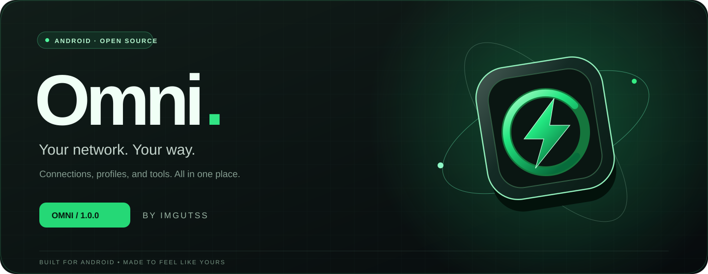
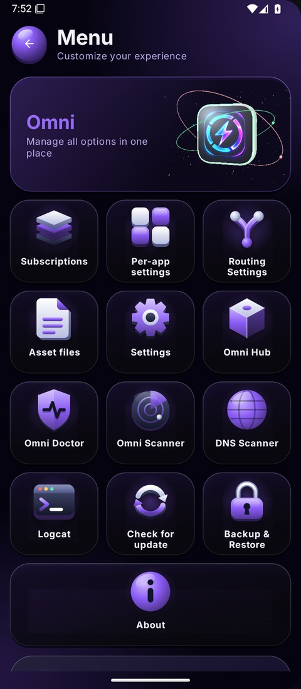
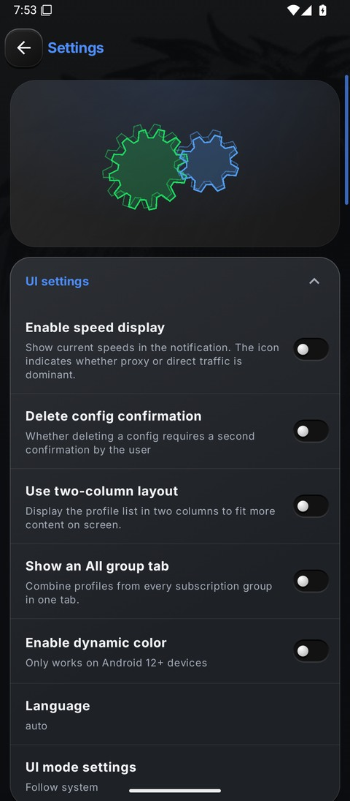
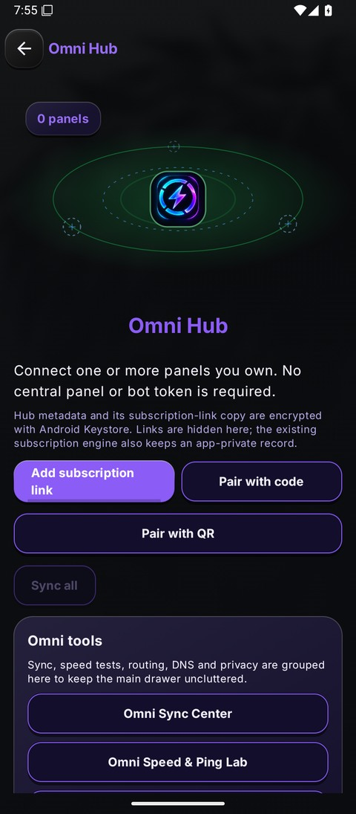

### شبکهٔ تو، به سبک تو.

اتصال‌ها، پروفایل‌ها و ابزارهای روزمرهٔ شبکه؛ همه در یک برنامه.

**[دانلود Omni](https://github.com/imgutss/Omni-App/releases/latest)** · **[English](README.md)** · [راهنمای شروع](docs/GETTING_STARTED.md)

## کمی عمق، کلی اختیار

نورپردازی نرم، آیکون‌های چندلایه و رنگ‌هایی که انتخابشان با توست. با **۱۹ تم**، حالت روشن و تاریک و جلوه‌های قابل تنظیم، ظاهر Omni را به سلیقهٔ خودت نزدیک کن.

<table>
<tr><td align="center"><b>هر چیز سر جای خودش</b></td><td align="center"><b>رنگ و حال دلخواهت</b></td><td align="center"><b>ابزارها در Omni Hub</b></td></tr>
<tr>
<td width="33%"></td>
<td width="33%"></td>
<td width="33%"></td>
</tr>
</table>

## برای اتصال‌های تو

**پروفایل‌هایت را همراه بیاور.** لینک وارد کن، QR اسکن کن یا یک کانفیگ بساز. اشتراک‌ها را مرتب نگه دار و هر وقت لازم شد، پروفایل را عوض کن.

**مسیر را خودت انتخاب کن.** قوانین مسیریابی و دسترسی برنامه‌ها را تنظیم کن، جزئیات پروتکل را ویرایش کن و از تنظیماتت نسخهٔ پشتیبان بگیر.

**ابزارها را دم دست داشته باش.** در Omni Hub سراغ ابزارهای DNS، مسیریابی، همگام‌سازی، حریم خصوصی و سنجش سرعت و پینگ برو. لاگ‌ها و عیب‌یابی هم در دسترس‌اند.

**با ترکیب دلخواهت کار کن.** پروفایل‌های مبتنی بر Xray، امکانات Aether/WARP، وایرگارد استاندارد، NaiveProxy و دیگر موتورهای پشتیبانی‌شده در اختیارت هستند.

## نسخهٔ مناسب گوشی تو

برای بیشتر گوشی‌های امروزی، **نسخهٔ کامل ARM64** انتخاب مناسبی است.

**[دانلود مستقیم ARM64](https://github.com/imgutss/Omni-App/releases/download/v1.0.0/Omni_1.0.0_arm64-v8a.apk)** · **[همهٔ فایل‌های نصب](https://github.com/imgutss/Omni-App/releases/latest)**

- گوشی‌های قدیمی ۳۲ بیتی: `armeabi-v7a`
- دستگاه‌های اینتل و شبیه‌سازها: `x86` یا `x86_64`
- اگر از معماری دستگاه مطمئن نیستی: `universal`

نسخه‌های کم‌حجم `slim` و `nolibs-guts` برای استفاده‌های تخصصی ارائه می‌شوند و بعضی موتورهای نسخهٔ کامل را ندارند. برای بررسی فایل دانلودشده، هش آن را با `SHA256SUMS` همان انتشار مقایسه کن.

## اولین اتصال، در سه قدم

**۱. نصب کن.** فایل مناسب دستگاهت را بگیر. برای به‌روزرسانی نصب رسمی قبلی لازم نیست برنامه را پاک کنی؛ تنظیمات محلی‌ات را نگه دار.

**۲. پروفایل اضافه کن.** یک کانفیگ یا اشتراک از ارائه‌دهنده‌ای که به آن اعتماد داری وارد کن.

**۳. وصل شو.** پروفایل را انتخاب کن، دکمهٔ روشن‌کردن را بزن و مجوز VPN اندروید را تأیید کن.

برای اتصال به کانفیگ معتبر خودت نیاز داری. Omni سرویس فروش اشتراک نیست؛ در دسترس بودن اتصال به ارائه‌دهنده، تنظیمات و شبکهٔ تو بستگی دارد.

## با هم بهترش کنیم

[گزارش مشکل یا پیشنهاد](https://github.com/imgutss/Omni-App/issues/new/choose) · [ساخت از سورس](docs/BUILDING.md) · [مشارکت در توسعه](CONTRIBUTING.md)

قبل از فرستادن لاگ یا تصویر، لینک اشتراک، کلید خصوصی و اطلاعات حساس را پاک کن. برای گزارش‌های حساس، [راهنمای امنیت](SECURITY.md) را ببین.

 

**OMNI · IMGUTSS**

شبکهٔ تو، به سبک تو.

[حریم خصوصی](docs/PRIVACY.md) · [مجوز](LICENSE) · [مجوزها و اعتبار اجزای استفاده‌شده](docs/CREDITS.md)

