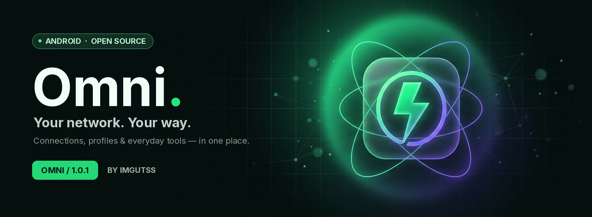
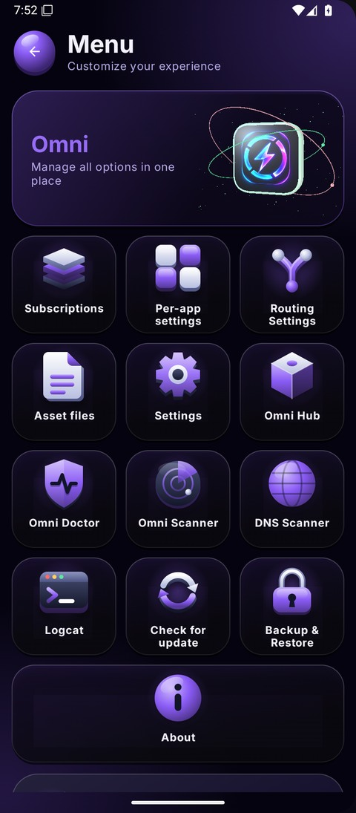
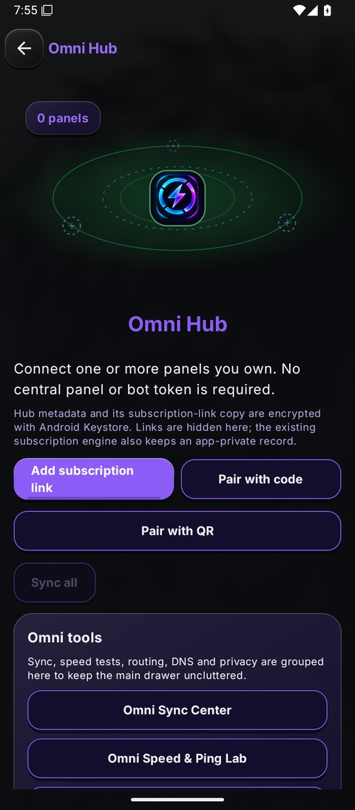
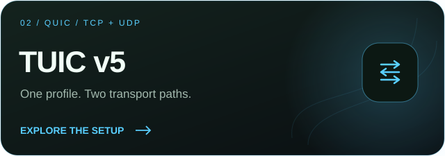
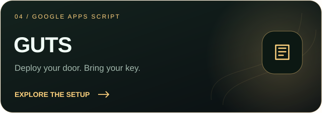
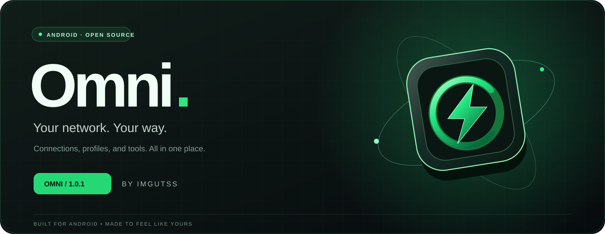

<div align="center">



<br /><br />

[](https://github.com/imgutss/Omni-App/releases/latest)
[](https://github.com/imgutss/Omni-App/releases)
[](#نسخهٔ-مناسب-گوشی-تو)
[](LICENSE)

### شبکهٔ تو، به سبک تو.

اتصال‌ها، پروفایل‌ها و ابزارهای روزمرهٔ شبکه؛ همه در یک برنامه —<br />
ساخته‌شده برای اندروید، با وسواس تا آخرین جزئیات.

**[⬇ دانلود Omni](https://github.com/imgutss/Omni-App/releases/latest)** &nbsp;·&nbsp; **[English](README.md)** &nbsp;·&nbsp; **[راهنمای شروع](#-شروع-سریع)** &nbsp;·&nbsp; **[تازه‌ها](#-تازهها-در-۱۰۱)**

</div>

<div dir="rtl">

## خلاصهٔ ماجرا

Omni یک کلاینت بومی اندروید است که هر روشی که با آن وصل می‌شوی را در یک جای آرام و مرتب جمع می‌کند. یک پروفایل وارد کن، QR اسکن کن، یا با حساب Firefox VPN خودت وارد شو — بعد مسیر، جابه‌جایی خودکار و عیب‌یابی را به Omni بسپار. بدون شلوغی، بدون دکمه‌های مرموز، و بدون نشت ترافیک وقتی تونل قطع می‌شود.

پروتکل‌هایی که همین حالا استفاده می‌کنی را بلد است (Xray، WireGuard، NaiveProxy، TUIC، ShadowQUIC و بیشتر)، آن‌ها را در **۱۹ تمِ دست‌ساز** می‌پیچد، و یک **مرکز فایرفاکس** کامل اضافه می‌کند برای کسی که فقط یک اتصال خصوصی و سالم می‌خواهد، بدون درگیرشدن با ترنسپورت و DNS.

## ✨ تازه‌ها در ۱.۰.۱

**مرکز فایرفاکس** حالا یک بخش مستقل و درجه‌یکِ برنامه است — و پایدار.

- 🦊 **مرکز فایرفاکس** — با حساب Firefox خودت وارد شو و از مکان‌های VPN موزیلا وصل شو؛ با داشبورد زنده، پزشک اتصال و جابه‌جایی خودکار.
- 🛠️ **زبانهٔ ابزارها، اصلاح شد** — نسخه‌های یک‌ضربتی تمیز اعمال می‌شوند و زبانه دیگر هنگام بازکردن کرش نمی‌کند.
- 🌍 **مکان‌هایی که پاسخ می‌دهند** — انتخاب کشور حالا می‌ماند و «فعال» نشان داده می‌شود، حتی پیش از بالاآمدن تونل.
- 📶 **روی ایرانسل کار می‌کند** — بوت‌استرپ چندمسیرهٔ DNS یعنی اتصال روی شبکه‌هایی که DNS رمزنگاری‌شده را می‌بندند هم زنده می‌ماند، درست مثل همراه اول.

> از نسخهٔ قدیمی Omni به‌روزرسانی می‌کنی؟ مستقیم روی همان نصب کن — پروفایل‌ها و تنظیماتت سر جایشان می‌مانند.

## 🦊 مرکز فایرفاکس

یک تجربهٔ کامل و مستقل برای VPN فایرفاکسِ موزیلا. از **منو ← فایرفاکس** وارد شو؛ شش زبانه داری:

| زبانه | کارش چیست |
| :--- | :--- |
| **اتصال** | دکمهٔ روشن/خاموش، وضعیت حساب، حلقهٔ سهمیهٔ زنده، سرعت لحظه‌ای، مصرف امروز، تأخیر و کشور فعلی. |
| **کنترل** | اتاق فرمان: کشور و شهر، سرعت ↓/↑، تأخیر، کیفیت، ترنسپورت، IP و کشور خروجی، وضعیت نشست و خط زمانی رویدادها. |
| **پزشک** | تشخیص گام‌به‌گام با ✓/✗ — موتور، ورود، Guardian، گذر، سهمیه، فهرست سرور، DNS و نشت، تونل، IP خروجی، تطابق کشور و ترنسپورت — به‌همراه یک پیشنهاد روشن. حالت تست زنده هم دارد. |
| **مکان‌ها** | همهٔ کشورهایی که Firefox VPN ارائه می‌دهد، با پینگ و jitter. انتخاب، ستاره‌دارکردن یا قفل کشور. |
| **حساب‌ها** | افزودن یا ورود حساب Firefox خودت (کد ایمیل / تصویر امنیتی)، فعال‌سازی، به‌روزرسانی سهمیه، حذف و دیدن سلامت هر حساب. |
| **ابزارها** | نسخه‌های یک‌ضربتی، محافظ‌ها، ممیزی حریم خصوصی و جعبهٔ سیاهِ محلی رویدادها. |

**خودش مراقب خودش است:**

- 🎯 **بهترین مکان خودکار** — فقط روی افت شدید یا قطعی جابه‌جا می‌شود، هرگز وسط دانلود، و همیشه به قفل کشور و ستاره‌دارها احترام می‌گذارد.
- 🔋 **اتوپایلوت سهمیه** — با کم‌شدن سهمیه خبر می‌دهد و در پایان، تونل را به موتور دیگری می‌سپارد تا آفلاین نمانی.
- 🛡️ **سپر هیبریدی** — جابه‌جایی هوشمندی که هرگز به مسیر مستقیم و نشتی برنمی‌گردد.
- 🩺 **نگهبان نشست** — بالادستِ گیرکرده را یک‌بار بی‌صدا درجا راه‌اندازی مجدد می‌کند.
- 🧬 **DNA شبکه** — نشان می‌دهد کدام مسیر DNS روی همین شبکه‌ای که الان رویش هستی واقعاً جواب می‌دهد.
- ⚡ **نسخه‌های یک‌ضربتی** — *تماشای فیلم، بازی، حریم خصوصی، صرفه‌جویی سهمیه* و *عبور از فیلترینگ* با یک ضربه موتور را برای کارت تنظیم می‌کنند.

## 📱 یک گشت در برنامه

</div>

<table>
<tr>
<td width="33%" align="center"><b>هر چیز سر جای خودش</b></td>
<td width="33%" align="center"><b>رنگ و حال دلخواهت</b></td>
<td width="33%" align="center"><b>ابزارها دم دست</b></td>
</tr>
<tr>
<td width="33%"></td>
<td width="33%"></td>
<td width="33%"></td>
</tr>
</table>

<div dir="rtl">

## 🧰 بقیهٔ کارهایی که Omni می‌کند

**پروفایل‌هایت را همراه بیاور.** لینک وارد کن، QR اسکن کن یا دستی کانفیگ بساز. اشتراک‌ها را مرتب نگه دار و هر وقت لازم شد پروفایل را عوض کن.

**مسیر را خودت انتخاب کن.** قوانین مسیریابی و دسترسی برنامه‌ها را تنظیم کن، جزئیات پروتکل را ویرایش کن، فایل‌های asset را مدیریت کن و از کل تنظیماتت پشتیبان بگیر.

**ابزارها را دم دست داشته باش.** Omni Hub ابزارهای DNS Lab، Routing Studio، Sync Center، Speed & Ping Lab و Privacy & Backup را — به‌همراه Omni Doctor، Omni Scanner و DNS Scanner — یک‌جا جمع می‌کند تا منوی اصلی شلوغ نماند.

**مال خودت کن.** ۱۹ تم، حالت روشن و تاریک، و جلوه‌هایی که می‌توانی زیاد یا کم کنی.

## 🔌 روش‌های اتصال

Omni ذاتاً چندنموتوره است. مسیری را انتخاب کن که به شبکه و ارائه‌دهنده‌ات می‌خورد.

| موتور | مسیر اتصال | راهنما |
| :--- | :--- | :--- |
| **Firefox VPN** | حساب موزیلا، مکان‌ها، سهمیه و جابه‌جایی خودکار — دکمهٔ آسان | [مرکز فایرفاکس](#-مرکز-فایرفاکس) |
| **Xray** | VLESS / VMess / Trojan / Shadowsocks و دوستانشان | [شروع سریع](#-شروع-سریع) |
| **WireGuard** | پروفایل‌های استاندارد WireGuard | [شروع سریع](#-شروع-سریع) |
| **Aether / WARP** | اتصال مبتنی بر Cloudflare WARP | [شروع سریع](#-شروع-سریع) |
| **NaiveProxy** | کلاینت مبتنی بر Chromium، HTTPS/HTTP2 و سرور Caddy با احراز هویت | [سرور + پروفایل](docs/protocols/naiveproxy.fa.md) |
| **TUIC v5** | ارتباط QUIC، کاربر UUID و رلهٔ TCP و UDP | [سرور + پروفایل](docs/protocols/tuic.fa.md) |
| **ShadowQUIC** | سرور QUIC مستقل، نام JLS و مشخصات هر کاربر | [سرور + پروفایل](docs/protocols/shadowquic.fa.md) |
| **GUTS Fetch** | دروازهٔ شخصی Google Apps Script با گواهی محلی گوشی | [دیپلوی + پروفایل](docs/protocols/guts.fa.md) |

</div>

<table>
<tr>
<td width="50%"><a href="docs/protocols/naiveproxy.fa.md"></a></td>
<td width="50%"><a href="docs/protocols/tuic.fa.md"></a></td>
</tr><tr>
<td width="50%"><a href="docs/protocols/shadowquic.fa.md"></a></td>
<td width="50%"><a href="docs/protocols/guts.fa.md"></a></td>
</tr>
</table>

<div dir="rtl">

<details>
<summary><b>GUTS — از <code>Code.gs</code> تا دروازهٔ شخصی تو</b></summary>

فایل **[Code.gs](docs/guts/Code.gs)** را در [Google Apps Script](https://script.google.com/) دیپلوی کن، یک رمز مشترک خصوصی بگذار و نشانی `/exec` را در GUTS وارد کن. این حالت **Certificate / Fetch** است و به VPS یا نود خروجی نیاز ندارد. کاربردش وب HTTP/HTTPS برای کلاینت‌هایی است که به CA شخصی تو اعتماد می‌کنند، نه TCP/UDP دلخواه. پیش از نصب CA، بخش گواهی و حریم خصوصیِ [راهنمای کامل](docs/protocols/guts.fa.md) را بخوان.

</details>

## 🚀 شروع سریع

### ۱ · نصب

فایل مناسب دستگاهت را از **[Releases](https://github.com/imgutss/Omni-App/releases/latest)** بگیر (بیشتر گوشی‌های امروزی **arm64-v8a** می‌خواهند) و نصب کن. به‌روزرسانی روی نسخهٔ رسمی قبلی، تنظیمات محلی‌ات را نگه می‌دارد — نیازی به حذف نیست.

<details>
<summary>بررسی فایل دانلودشده (پیشنهاد می‌شود)</summary>

هر انتشار یک `SHA256SUMS` دارد. فایلت را با آن مقایسه کن:

```sh
sha256sum Omni_1.0.1_arm64-v8a.apk
# این مقدار را با همان نام فایل در SHA256SUMS مطابقت بده.
```

</details>

### ۲ · اولین اتصال

۱. **پروفایل اضافه کن** — یک کانفیگ یا اشتراک از ارائه‌دهنده‌ای که به آن اعتماد داری وارد کن (لینک، QR یا فایل).
۲. آن را در لیست **انتخاب کن**.
۳. **دکمهٔ روشن‌کردن** را بزن و مجوز VPN اندروید را تأیید کن.

تمام. کانفیگ معتبر را خودت می‌آوری — Omni سرویس فروش اشتراک نیست و در دسترس بودن اتصال به ارائه‌دهنده، تنظیمات و شبکه‌ات بستگی دارد.

### ۳ · یا فقط از مرکز فایرفاکس استفاده کن

۱. **منو ← فایرفاکس** را باز کن.
۲. در **حساب‌ها** با حساب Firefox خودت وارد شو.
۳. در **مکان‌ها** یک کشور انتخاب کن (یا روی *پیشنهادی* بگذار).
۴. **اتصال** را بزن. اگر چیزی درست نبود، **پزشک** را باز کن تا به زبان ساده بگوید مشکل کجاست.

### ۴ · حرکت‌های حرفه‌ای‌ها

- در **ابزارها** یک **نسخه** اعمال کن تا با کارت جور شود (فیلم، بازی، حریم خصوصی…).
- **بهترین مکان خودکار** را روشن کن تا Omni خودش تو را روی یک مکان سالم نگه دارد.
- **اتوپایلوت سهمیه** را فعال کن تا سهمیهٔ تمام‌شده هیچ‌وقت تو را بی‌اتصال نگذارد.

> **نکتهٔ عیب‌یابی:** اگر اتصالی شکست خورد، لاگ و کانفیگ واقعی را بررسی کن. اعتبارنامهٔ نامعتبر، مقصد دردسترس‌نبودنی یا مسدودسازی شبکه با عوض‌کردن تم درست نمی‌شود. هنگام کمک‌خواستن، لینک اشتراک، کلیدها و ترافیک شخصی را پاک کن.

## 🎨 نسخهٔ مناسب گوشی تو

| دستگاه تو | فایل پیشنهادی |
| :--- | :--- |
| **بیشتر گوشی‌های امروزی** | **[نسخهٔ کامل arm64-v8a](https://github.com/imgutss/Omni-App/releases/latest)** |
| گوشی‌های قدیمی ۳۲ بیتی ARM | `armeabi-v7a` |
| دستگاه‌های اینتل و شبیه‌سازها | `x86` / `x86_64` |
| مطمئن نیستی چه معماری‌ای داری | `universal` |

نسخهٔ **کامل** بهترین نقطهٔ شروع است. نسخه‌های کم‌حجم `slim` و `nolibs-guts` برای استفاده‌های تخصصی‌اند. هر انتشار `SHA256SUMS` دارد.

**[همهٔ فایل‌های نصب ←](https://github.com/imgutss/Omni-App/releases/latest)**

## 🔒 حریم خصوصی و امنیت

- حساب‌ها، رمزها و توکن‌ها **روی دستگاه خودت** می‌مانند و فقط با سرورهای خودِ ارائه‌دهنده حرف می‌زنند (برای مرکز فایرفاکس، سرورهای موزیلا).
- جعبهٔ سیاه فایرفاکس **فقط رویداد و دلیل** را ثبت می‌کند — هیچ آدرس بازدید، رمز یا توکنی.
- اگر تونل نتواند ترافیک را ببرد، اتصال **قطع می‌شود، نه اینکه مستقیم نشت کند**.
- Omni یک برنامهٔ مستقل است و محصول رسمی موزیلا **نیست**.

آسیب‌پذیری پیدا کردی؟ لطفاً به‌جای ایشوی عمومی، [راهنمای امنیت](SECURITY.md) را دنبال کن. [یادداشت‌های کامل حریم خصوصی](docs/PRIVACY.md) را بخوان.

## 🛠️ ساخت از سورس

پروژهٔ برنامه در `V2rayNG/` است. ساب‌ماژول‌های پین‌شده را مقداردهی کن و بعد اسکریپت‌های ساخت موتور و ورک‌فلوی CI را دنبال کن:

```sh
git submodule update --init --recursive
```

زنجیره‌ابزار Android/NDK، Rust و Go، پین وابستگی‌ها و گام‌های دقیق ساخت در [`.github/workflows/omni-build.yml`](.github/workflows/omni-build.yml) و [`docs/BUILDING.md`](docs/BUILDING.md) مشخص شده‌اند. انتشارهای رسمی در CI ساخته و امضا می‌شوند و پیش از انتشار روی شبیه‌ساز اندروید ۱۵ آزموده می‌شوند.

## ❓ پرسش‌های پرتکرار

<details>
<summary><b>Omni اشتراک می‌فروشد یا سرور می‌دهد؟</b></summary>

نه. Omni یک کلاینت است. پروفایل، اشتراک یا حساب Firefox را خودت می‌آوری. در دسترس بودن اتصال به ارائه‌دهنده و شبکه‌ات بستگی دارد.

</details>

<details>
<summary><b>به‌روزرسانی پروفایل‌هایم را پاک می‌کند؟</b></summary>

نه. روی نسخهٔ رسمی قبلی نصب کن (شناسهٔ برنامه <code>net.omnigate.app</code> می‌ماند و version code بالا می‌رود). اول از پروفایل‌های مهم پشتیبان بگیر و حذف نکن مگر اینکه بخواهی دادهٔ محلی پاک شود.

</details>

<details>
<summary><b>چه نسخه‌های اندرویدی پشتیبانی می‌شوند؟</b></summary>

اندروید ۱۰ (API 29) و جدیدتر.

</details>

<details>
<summary><b>این یک برنامهٔ رسمی فایرفاکس / موزیلا است؟</b></summary>

نه. Omni مستقل است. مرکز فایرفاکس با حساب خودت به VPN فایرفاکسِ موزیلا وصل می‌شود و وابسته به موزیلا یا مورد تأیید آن نیست.

</details>

## 🤝 با هم بهترش کنیم

[گزارش مشکل](https://github.com/imgutss/Omni-App/issues/new/choose) · [پیشنهاد](https://github.com/imgutss/Omni-App/issues/new/choose) · [ساخت از سورس](docs/BUILDING.md) · [مشارکت](CONTRIBUTING.md)

پیش از فرستادن لاگ یا تصویر، کلید خصوصی، لینک اشتراک و اطلاعات حساس را پاک کن.

</div>

<div align="center">

<br />



<br /><br />

**OMNI · IMGUTSS**

شبکهٔ تو، به سبک تو.

[حریم خصوصی](docs/PRIVACY.md) &nbsp;·&nbsp; [مجوز](LICENSE) &nbsp;·&nbsp; [اعتبار اجزای استفاده‌شده](docs/CREDITS.md)

</div>
