<div dir="rtl">



<br>

**Omni** یک کلاینت بومی اندروید برای اتصال‌هایی است که خودتان تهیه یا راه‌اندازی می‌کنید. موتورهای تونل مستقیم روی گوشی اجرا می‌شوند، پروفایل‌ها و اشتراک‌هایتان یک‌جا می‌مانند و خود برنامه هیچ سرور یا اشتراکی همراه ندارد.

[دانلود آخرین نسخه](https://github.com/imgutss/Omni-App/releases/latest)&ensp;&ensp;[English](README.md)&ensp;&ensp;[سورس](https://github.com/imgutss/omni-android)

## امکانات

پروفایل را با لینک، QR یا آدرس اشتراک اضافه کنید. Omni فرمت‌های رایج را می‌شناسد و لینک‌های خودش (`omni://`، `guts://` و `masterdns://`) را هم باز می‌کند.

قانون‌ها مشخص می‌کنند کدام برنامه‌ها از تونل رد شوند و کدام مستقیم بروند. مسیریابی هر برنامه، مجموعه‌قانون‌های مسیریابی و DNS کنار هم هستند.

Omni Hub جای ابزارهای جانبی است: کمک‌ابزارهای DNS و مسیریابی، همگام‌سازی، گزینه‌های حریم خصوصی، تست سرعت و پینگ، لاگ و عیب‌یابی. هاب می‌تواند به پنل‌هایی که خودتان راه انداخته‌اید وصل شود و اشتراک‌هایشان را همگام نگه دارد.

رابط کاربری با Jetpack Compose نوشته شده و ۱۹ اسکین و سه سطح افکت دارد. انتخاب شما بعد از بستن برنامه هم می‌ماند.

## ساختار



پروفایل به یک موتور سپرده می‌شود، قانون‌ها تعیین می‌کنند چه ترافیکی به آن برسد و VpnService اندروید آن را حمل می‌کند. هیچ‌جای این زنجیره WebView نیست.

## دانلود

| گوشی شما | فایل APK |
| --- | --- |
| بیشتر گوشی‌های امروزی | `arm64-v8a` |
| گوشی‌های قدیمی ۳۲ بیتی | `armeabi-v7a` |
| دستگاه‌های Intel و شبیه‌ساز | `x86_64` یا `x86` |
| مطمئن نیستید | `universal` |

نام فایل‌ها شبیه `Omni_<version>_arm64-v8a.apk` است. از نسخهٔ کامل شروع کنید. نسخه‌های slim و nolibs-guts کتابخانه‌های بومی کمتری دارند و برای شرایط خاص‌اند. فایل universal چند برابر حجیم‌تر است، چون همهٔ معماری‌ها را یک‌جا دارد.

اگر روی نسخهٔ رسمی قبلی نصب کنید، تنظیماتتان می‌ماند و لازم نیست اول حذفش کنید.

## اولین اتصال



1. فایل APK را نصب کنید. بار اول، اندروید اجازهٔ نصب از مرورگر یا فایل‌منیجر را می‌پرسد.
2. یک پروفایل اضافه کنید: کانفیگ یا اشتراکی که از ارائه‌دهندهٔ مورد اعتمادتان گرفته‌اید، یا از سرور خودتان.
3. پروفایل را انتخاب کنید، دکمهٔ پاور را بزنید و مجوز VPN اندروید را تأیید کنید.

Omni اشتراک یا سرویس خودش را ندارد، پس به یک کانفیگ سالم نیاز دارید. اینکه وصل شود یا نه به ارائه‌دهنده، تنظیمات و شبکهٔ شما بستگی دارد.

## موتورها

| موتور | خوب است بدانید |
| --- | --- |
| Xray | VLESS، VMess، Trojan، Shadowsocks، Hysteria2، WireGuard و بیشتر |
| Aether / WARP | پروفایل‌های موتور Aether و WARP |
| WireGuard | کانفیگ‌های ساده‌ی WireGuard |
| NaiveProxy | سرور شخصی با Caddy و احراز هویت لازم است |
| TUIC v5 | QUIC با احراز هویت UUID؛ TCP و UDP را رله می‌کند. سرور شخصی لازم است |
| ShadowQUIC | سرور QUIC اختصاصی با نام JLS و مشخصات جداگانهٔ هر کاربر |
| GUTS Fetch | از طریق Google Apps Script خودتان و یک گواهی شخصی دستگاه کار می‌کند. UDP ندارد |
| MasterDNS | کلاینت تونل DNS. کانفیگ JSON، TOML یا Base64 یا لینک `masterdns://` را وارد کنید |

## بررسی فایل دانلودشده

هر ریلیز یک فایل `SHA256SUMS` دارد و همهٔ APKها امضا شده‌اند. هش فایلی که دانلود کرده‌اید را حساب کنید و با خط مربوطش مقایسه کنید.

<div dir="ltr">

```sh
# Linux
sha256sum -c SHA256SUMS --ignore-missing
```

```powershell
# Windows
Get-FileHash .\Omni_*_arm64-v8a.apk -Algorithm SHA256
```

</div>

## سورس

هستهٔ اندرویدی Omni روی بستر v2rayNG و از مسیر PattNG ساخته شده و از Xray-core و موتورهای بالا استفاده می‌کند. تاریخچه و مجوز مخازن بالادستی در [imgutss/omni-android](https://github.com/imgutss/omni-android) نگه داشته شده است؛ سورس همان‌جاست.

## مجوز

فایل [LICENSE](LICENSE) را ببینید.

</div>
