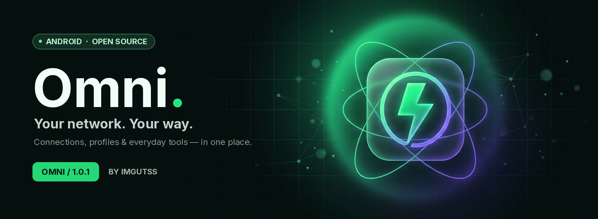
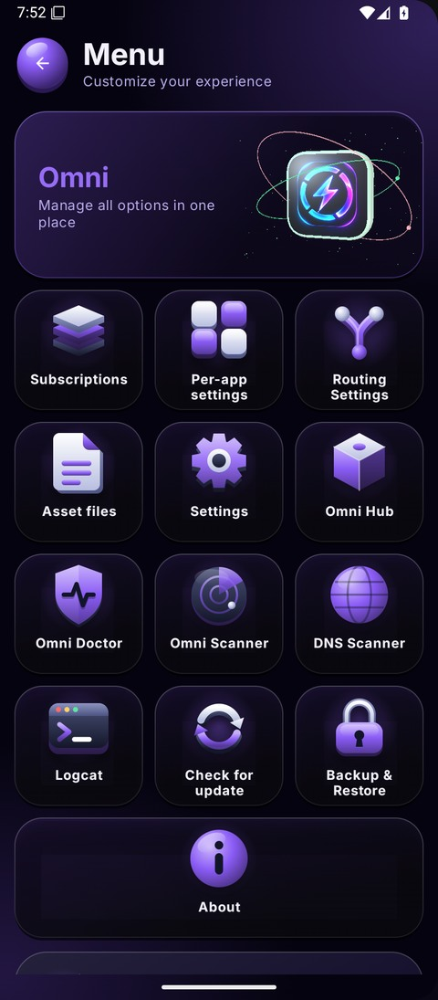
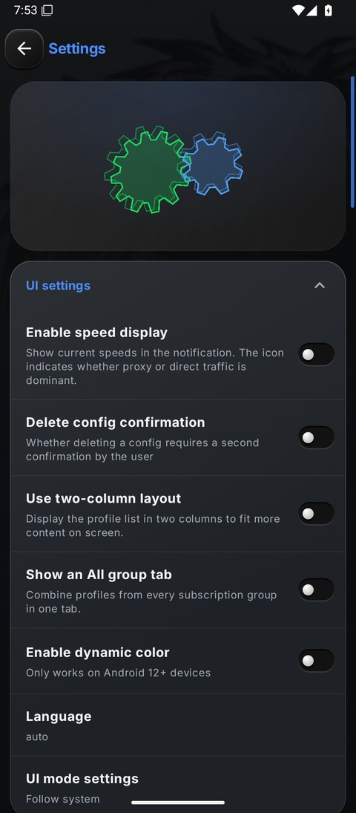
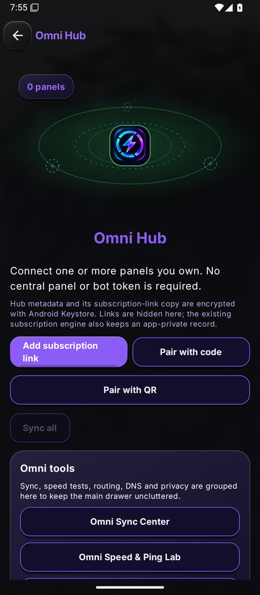
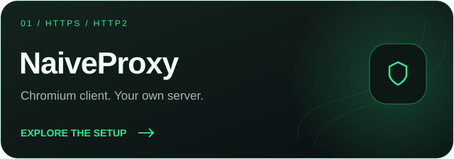
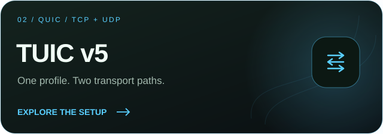
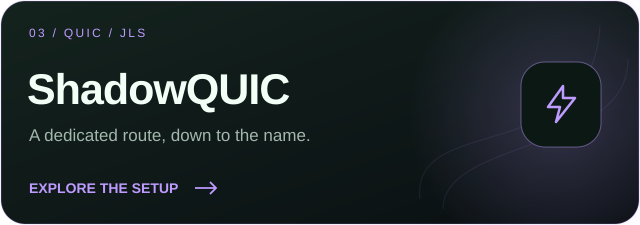
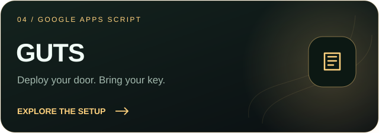
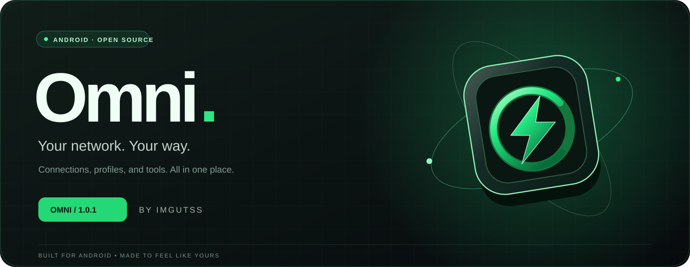

<div align="center">



<br /><br />

[](https://github.com/imgutss/Omni-App/releases/latest)
[](https://github.com/imgutss/Omni-App/releases)
[](#pick-your-download)
[](LICENSE)

### Your network. Your way.

One app for your connections, profiles, and everyday network tools —<br />
thoughtfully designed for Android, down to the last detail.

**[⬇ Download Omni](https://github.com/imgutss/Omni-App/releases/latest)** &nbsp;·&nbsp; **[راهنمای فارسی](README.fa.md)** &nbsp;·&nbsp; **[Getting started](#-quick-start)** &nbsp;·&nbsp; **[What's new](#-new-in-101)**

</div>

<br />

## The short version

Omni is a native Android client that brings every way you connect into one calm, considered place. Import a profile, scan a QR code, or sign in to your own Firefox VPN account — then let Omni handle the route, the failover, and the diagnostics. No clutter, no mystery buttons, no leaked traffic when a tunnel drops.

It speaks the protocols you already use (Xray, WireGuard, NaiveProxy, TUIC, ShadowQUIC and more), wraps them in **19 hand-tuned themes**, and adds a full **Firefox Hub** for people who just want a private, working connection without thinking about transports and DNS.

<div align="right">

**[⬆ Back to top](#)**

</div>

## ✨ New in 1.0.1

The **Firefox Hub** is now a first-class, independent part of the app — and it's stable.

- 🦊 **Firefox Hub** — sign in with your own Firefox account and connect through Mozilla's VPN locations, with a live dashboard, a connection doctor, and automatic failover.
- 🛠️ **Tools tab, fixed** — one-tap recipes apply cleanly, and the tab no longer crashes when you open it.
- 🌍 **Locations that respond** — picking a country now sticks and shows as active, even before the tunnel comes up.
- 📶 **Works on Irancell** — a multi-path DNS bootstrap means the connection survives networks that block encrypted DNS, just like on MCI.

> Updating from an older Omni? Install straight over it — your profiles and settings stay put.

<div align="right">

**[⬆ Back to top](#)**

</div>

## 🦊 Firefox Hub

A complete, self-contained experience for Mozilla's Firefox VPN. Open **Menu → Firefox** and you get six tabs:

| Tab | What it does |
| :--- | :--- |
| **Connect** | Power button, account status, a live quota ring, real-time speed, today's usage, latency, and your current country. |
| **Control** | Mission control: country & city, ↓/↑ speed, latency, quality, transport, exit IP & country, session state, and an event timeline. |
| **Doctor** | Step-by-step diagnosis with ✓/✗ — engine, sign-in, Guardian, pass, quota, server list, DNS & leaks, tunnel, exit IP, country match, transport — plus one clear recommendation. Has a live-test mode. |
| **Locations** | Every country Firefox VPN offers, with ping & jitter. Select, favourite, or lock a country. |
| **Accounts** | Add or sign in to your own Firefox account (email code / security image), activate, refresh quota, remove, and see each account's health. |
| **Tools** | One-tap recipes, shields, a privacy audit, and a local event blackbox. |

**It looks after itself:**

- 🎯 **Auto Best Location** — moves only on a severe drop or disconnect, never mid-download, and always respects your country lock and favourites.
- 🔋 **Quota autopilot** — warns you as the allowance runs low and, at exhaustion, hands the tunnel to another engine instead of leaving you offline.
- 🛡️ **Hybrid Shield** — smart failover that never falls back to a direct, leaking connection.
- 🩺 **Session Guardian** — quietly restarts a stalled upstream once before handing off.
- 🧬 **Network DNA** — shows which DNS path actually works on the network you're on right now.
- ⚡ **One-tap recipes** — *Streaming, Gaming, Privacy, Save Quota,* and *Bypass* set the engine up for what you're doing in a single tap.

<div align="right">

**[⬆ Back to top](#)**

</div>

## 📱 A look around

<table>
<tr>
<td width="33%" align="center"><b>Everything in its place</b></td>
<td width="33%" align="center"><b>Your own atmosphere</b></td>
<td width="33%" align="center"><b>Tools within reach</b></td>
</tr>
<tr>
<td width="33%"></td>
<td width="33%"></td>
<td width="33%"></td>
</tr>
</table>

## 🧰 Everything else Omni does

**Bring your profiles.** Import a link, scan a QR code, or add a configuration by hand. Keep subscriptions together and switch profiles whenever you need to.

**Choose what goes where.** Fine-tune routing and per-app rules, edit protocol settings, manage asset files, and back up your whole configuration.

**Keep your tools close.** Omni Hub groups DNS Lab, Routing Studio, Sync Center, Speed & Ping Lab, and Privacy & Backup — plus Omni Doctor, Omni Scanner, and a DNS Scanner — so the main drawer stays uncluttered.

**Make it yours.** 19 themes, light and dark modes, and effects you can turn up or dial back.

<div align="right">

**[⬆ Back to top](#)**

</div>

## 🔌 Ways to connect

Omni is multi-engine by design. Use the route that fits your network and your provider.

| Engine | The route | Guide |
| :--- | :--- | :--- |
| **Firefox VPN** | Your Mozilla account, locations, quota & failover — the easy button | [Firefox Hub](#-firefox-hub) |
| **Xray** | VLESS / VMess / Trojan / Shadowsocks and friends | [Getting started](#-quick-start) |
| **WireGuard** | Plain WireGuard profiles | [Getting started](#-quick-start) |
| **Aether / WARP** | Cloudflare WARP-based connectivity | [Getting started](#-quick-start) |
| **NaiveProxy** | Chromium-based client, HTTPS/HTTP2, authenticated Caddy server | [Server + profile](docs/protocols/naiveproxy.md) |
| **TUIC v5** | QUIC transport, UUID auth, TCP & UDP relay | [Server + profile](docs/protocols/tuic.md) |
| **ShadowQUIC** | Dedicated QUIC server, JLS name, per-user credentials | [Server + profile](docs/protocols/shadowquic.md) |
| **GUTS Fetch** | Your own Google Apps Script door with a local device certificate | [Deploy + profile](docs/protocols/guts.md) |

<table>
<tr>
<td width="50%"><a href="docs/protocols/naiveproxy.md"></a></td>
<td width="50%"><a href="docs/protocols/tuic.md"></a></td>
</tr><tr>
<td width="50%"><a href="docs/protocols/shadowquic.md"></a></td>
<td width="50%"><a href="docs/protocols/guts.md"></a></td>
</tr>
</table>

<details>
<summary><b>GUTS — from <code>Code.gs</code> to your own door</b></summary>

<br />

[](https://github.com/imgutss/Omni-App/releases/download/v1.0.0/Code.gs)

Deploy **[Code.gs](docs/guts/Code.gs)** to [Google Apps Script](https://script.google.com/), set a private shared key, then paste the `/exec` URL into GUTS in Omni. This is **Certificate / Fetch mode**: no VPS or exit node required. It carries web HTTP/HTTPS for clients that trust your own local CA — not arbitrary TCP/UDP. Read the certificate and privacy notes in the [full guide](docs/protocols/guts.md) before installing a CA.

</details>

<div align="right">

**[⬆ Back to top](#)**

</div>

## 🚀 Quick start

### 1 · Install

Grab the APK for your device from **[Releases](https://github.com/imgutss/Omni-App/releases/latest)** (most modern phones want **arm64-v8a**), then install it. Updating an existing official Omni keeps your local setup — no uninstall needed.

<details>
<summary>Verify your download (recommended)</summary>

<br />

Every release ships a `SHA256SUMS`. Compare your file against it:

```sh
sha256sum Omni_1.0.1_arm64-v8a.apk
# Match this value to the same filename in SHA256SUMS.
```

</details>

### 2 · Make your first connection

1. **Add a profile** — import a configuration or subscription from a provider you trust (link, QR, or file).
2. **Select it** in the list.
3. **Tap the power button** and approve Android's VPN permission when prompted.

That's it. You bring your own working configuration — Omni isn't a subscription service, and availability depends on your provider, settings, and network.

### 3 · Or just use Firefox Hub

1. Open **Menu → Firefox**.
2. In **Accounts**, sign in with your own Firefox account.
3. In **Locations**, pick a country (or leave it on *Recommended*).
4. Hit **Connect**. If anything's off, open **Doctor** for a plain-language diagnosis.

### 4 · Power-user moves

- Apply a **recipe** in **Tools** to match what you're doing (streaming, gaming, privacy…).
- Turn on **Auto Best** to let Omni keep you on a working location automatically.
- Enable **Quota autopilot** so a spent allowance never leaves you stranded.

> **Troubleshooting tip:** if a connection fails, check the real logs and configuration. Invalid credentials, unreachable endpoints, or network blocks aren't fixed by changing the theme. When asking for help, redact subscription links, keys, and personal traffic.

<div align="right">

**[⬆ Back to top](#)**

</div>

## 🎨 Pick your download

| Your device | Recommended APK |
| :--- | :--- |
| **Most current Android phones** | **[Full arm64-v8a](https://github.com/imgutss/Omni-App/releases/latest)** |
| Older 32-bit ARM phones | `armeabi-v7a` |
| Intel devices & emulators | `x86` / `x86_64` |
| Not sure about the architecture | `universal` |

The **full** build is the best starting point. Reduced `slim` and `nolibs-guts` builds exist for specialized setups. Every release includes `SHA256SUMS`.

**[See every download →](https://github.com/imgutss/Omni-App/releases/latest)**

## 🔒 Privacy & security

- Your accounts, passwords, and tokens stay **on your device** and talk only to the relevant provider's own servers (Mozilla's, for Firefox Hub).
- The Firefox event blackbox records **events and reasons only** — no visited addresses, passwords, or tokens.
- If a tunnel can't carry traffic, the connection is **cut, not leaked** directly.
- Omni is an independent app and is **not** an official Mozilla product.

Found a vulnerability? Please follow the [security policy](SECURITY.md) rather than opening a public issue. Read the full [privacy notes](docs/PRIVACY.md).

## 🛠️ Build from source

The app project lives in `V2rayNG/`. Initialize the pinned submodules, then follow the engine build scripts and the CI workflow:

```sh
git submodule update --init --recursive
```

Android/NDK, Rust and Go toolchains, dependency pins, and the exact build steps are specified in [`.github/workflows/omni-build.yml`](.github/workflows/omni-build.yml) and [`docs/BUILDING.md`](docs/BUILDING.md). Official releases are built and signed in CI, and exercised on an Android 15 emulator before publication.

## ❓ FAQ

<details>
<summary><b>Does Omni sell subscriptions or provide servers?</b></summary>

<br />

No. Omni is a client. You bring your own profiles, subscriptions, or Firefox account. Connection availability depends on your provider and network.

</details>

<details>
<summary><b>Will updating wipe my profiles?</b></summary>

<br />

No. Install over an existing official Omni (the application ID stays <code>net.omnigate.app</code> and the version code increases). Back up important profiles first, and don't uninstall unless you mean to clear local data.

</details>

<details>
<summary><b>Which Android versions are supported?</b></summary>

<br />

Android 10 (API 29) and newer.

</details>

<details>
<summary><b>Is this an official Firefox / Mozilla app?</b></summary>

<br />

No. Omni is independent. The Firefox Hub connects to Mozilla's Firefox VPN using your own account; it is not affiliated with or endorsed by Mozilla.

</details>

## 🤝 Stay in the loop

[Report a bug](https://github.com/imgutss/Omni-App/issues/new/choose) · [Suggest an idea](https://github.com/imgutss/Omni-App/issues/new/choose) · [Build from source](docs/BUILDING.md) · [Contribute](CONTRIBUTING.md)

Please remove private keys, subscription links, and other sensitive information before sharing logs or screenshots.

<div align="center">

<br />



<br /><br />

**OMNI · IMGUTSS**

Your network. Your way.

[Privacy](docs/PRIVACY.md) &nbsp;·&nbsp; [License](LICENSE) &nbsp;·&nbsp; [Third-party notices](docs/CREDITS.md)

</div>
