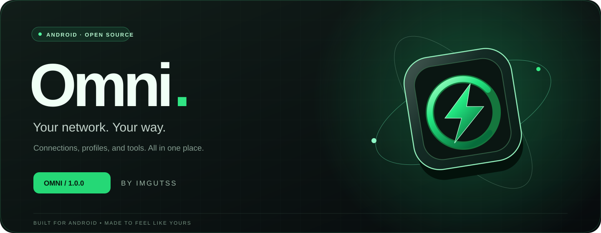
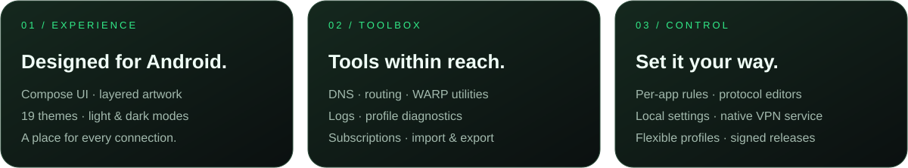
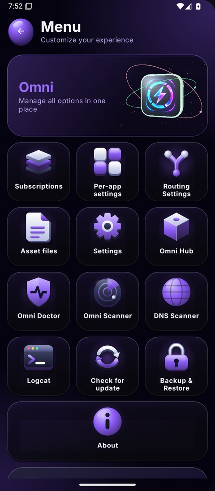
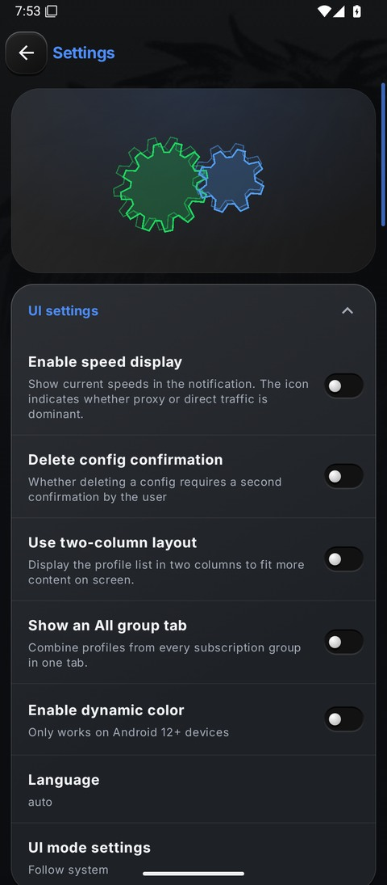
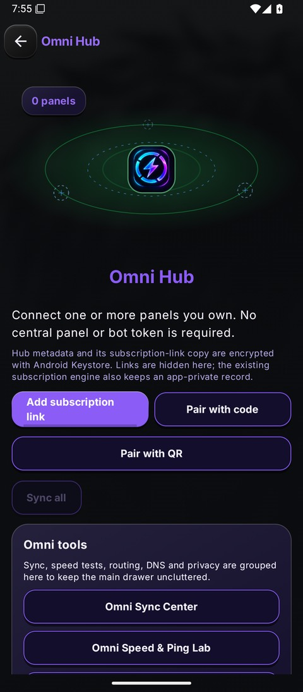

### Your network. Your way.

One place for your connections, profiles, and everyday network tools.
Thoughtfully designed for Android, down to the last detail.

**[Download Omni](https://github.com/imgutss/Omni-App/releases/latest)** &nbsp; · &nbsp; **[فارسی](README.fa.md)** &nbsp; · &nbsp; [Getting started](docs/GETTING_STARTED.md)

 

 

## A little depth. A lot of control.

Soft lighting. Layered artwork. A palette that feels like yours. Omni brings a distinctive look to the tools you use every day, with **19 themes**, light and dark modes, and effects you can turn up or dial back.

<table>
<tr><td align="center"><b>Everything in its place</b></td><td align="center"><b>Your own atmosphere</b></td><td align="center"><b>Meet Omni Hub</b></td></tr>
<tr>
<td width="33%"></td>
<td width="33%"></td>
<td width="33%"></td>
</tr>
</table>

## Built around your connections

**Bring your profiles.** Import a link, scan a QR code, or add a configuration. Keep subscriptions together and switch between profiles when you need to.

**Choose what goes where.** Fine-tune routing and per-app rules. Edit protocol settings, manage assets, and back up your configuration.

**Keep your tools close.** Open Omni Hub for DNS, routing, sync, privacy, and speed/ping utilities. Check logs or run diagnostics without leaving the app.

**Find your setup.** Work with Xray-based profiles, Aether/WARP, plain WireGuard, NaiveProxy, and the app's other supported engines.

## Pick your download

| Your device | Recommended APK |
| :--- | :--- |
| **Most current Android phones** | **[Full ARM64](https://github.com/imgutss/Omni-App/releases/download/v1.0.0/Omni_1.0.0_arm64-v8a.apk)** |
| Older 32-bit ARM phones | `armeabi-v7a` |
| Intel devices and emulators | `x86` or `x86_64` |
| Not sure about the architecture | `universal` |

[**See every download →**](https://github.com/imgutss/Omni-App/releases/latest)

The full build is the best starting point. Reduced `slim` and `nolibs-guts` builds are available for specialized setups. Every release includes `SHA256SUMS` for checking your download.

## Make your first connection

**01 — Install.** Choose the APK for your device. Updating an existing official installation keeps your local setup; you don't need to uninstall first.

**02 — Add a profile.** Import a configuration or subscription from a provider you trust.

**03 — Connect.** Select a profile, tap the power button, and approve Android's VPN permission when prompted.

You'll need your own working configuration. Omni doesn't include a subscription service; connection availability depends on your provider, settings, and network.

## Stay in the loop

[Report a bug](https://github.com/imgutss/Omni-App/issues/new/choose) · [Suggest an idea](https://github.com/imgutss/Omni-App/issues/new/choose) · [Build from source](docs/BUILDING.md) · [Contribute](CONTRIBUTING.md)

Please remove private keys, subscription links, and other sensitive information before sharing logs or screenshots. For sensitive reports, see the [security policy](SECURITY.md).

 

**OMNI · IMGUTSS**

Your network. Your way.

[Privacy](docs/PRIVACY.md) &nbsp; · &nbsp; [License](LICENSE) &nbsp; · &nbsp; [Third-party notices](docs/CREDITS.md)

