<br>

**Omni** is a native Android client for connections you set up yourself. The tunnel engines run on the phone, your profiles and subscriptions live in one place, and the app ships no servers or subscription of its own.

[Download the latest release](https://github.com/imgutss/Omni-App/releases/latest)&ensp;&ensp;[فارسی](README.fa.md)&ensp;&ensp;[Source](https://github.com/imgutss/omni-android)

## What's inside

Add a profile from a link, a QR code or a subscription URL. Omni opens the common share formats, plus its own `omni://`, `guts://` and `masterdns://` links.

Rules decide which apps go through the tunnel and which go around it. Per-app routing, routing rule sets and DNS sit together.

Omni Hub holds the extras: DNS and routing helpers, sync, privacy options, speed and ping tests, logs and diagnostics. It can also connect to panels you run yourself and keep their subscriptions in sync.

The interface is native Jetpack Compose, with 19 skins and three effect levels. Whatever you pick is still there after a restart.

## How it's put together



A profile goes to an engine, the rules decide which traffic reaches it, and Android's VpnService carries it. There is no WebView anywhere in that chain.

## Download

| Your phone | APK |
| --- | --- |
| Most current Android phones | `arm64-v8a` |
| Older 32-bit ARM phones | `armeabi-v7a` |
| Intel devices and emulators | `x86_64` or `x86` |
| Not sure | `universal` |

Files are named like `Omni_<version>_arm64-v8a.apk`. Start with the full build. The slim and nolibs-guts builds carry fewer bundled native libraries and are meant for specific setups. The universal APK is several times larger because it holds every architecture.

Installing over an existing official build keeps your local setup. You don't need to uninstall first.

## First connection


1. Install the APK. The first time, Android asks you to allow installs from your browser or file manager.
2. Add a profile: a configuration or subscription from a provider you trust, or one from your own server.
3. Pick the profile, press the power button and approve Android's VPN permission.

Omni has no subscription service of its own, so you need a working configuration. Whether it connects depends on your provider, your settings and your network.

## Engines

| Engine | Good to know |
| --- | --- |
| Xray | VLESS, VMess, Trojan, Shadowsocks, Hysteria2, WireGuard and more |
| Aether / WARP | Profiles for the Aether engine and WARP |
| WireGuard | Plain WireGuard configurations |
| NaiveProxy | Needs your own server running Caddy with authentication |
| TUIC v5 | QUIC with UUID authentication, relays TCP and UDP. Needs your own server |
| ShadowQUIC | Dedicated QUIC server with a JLS name and per-user credentials |
| GUTS Fetch | Goes through your own Google Apps Script deployment, with a personal device certificate. No UDP |
| MasterDNS | DNS tunnel client. Import a JSON, TOML or Base64 config, or a `masterdns://` link |

## Check your download

Every release has a `SHA256SUMS` file and every APK in it is signed. Hash the file you downloaded and compare it with the matching line.

```sh
# Linux
sha256sum -c SHA256SUMS --ignore-missing
```

```powershell
# Windows
Get-FileHash .\Omni_*_arm64-v8a.apk -Algorithm SHA256
```

## Source and credits

Omni's Android core is built on the v2rayNG lineage through PattNG, and it uses Xray-core and the engines above. Upstream history and licenses are kept in [imgutss/omni-android](https://github.com/imgutss/omni-android), where the source is.

## License

See [LICENSE](LICENSE).
